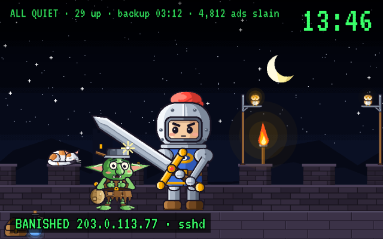

<div align="center">
  <picture>
    <source media="(prefers-color-scheme: dark)" srcset="web/logo-dark.svg">
    
  </picture>
  <h1>Knightwatcher</h1>
  <p>A pixel-art knight on your wall that acts out what your homelab is doing.</p>
  <p><a href="LICENSE"></a>
    <a href="https://github.com/knightwatcher-io/knightwatcher/releases/latest"></a>
    <a href="https://github.com/knightwatcher-io/knightwatcher/actions/workflows/ci.yml"></a></p>
  <p><a href="https://knightwatcher.io/demo/?demo">Live demo</a> · <a href="https://knightwatcher.io/">Website</a> · <a href="docs/README.md">Docs</a> · <a href=".github/CONTRIBUTING.md">Contributing</a> · <a href="https://www.reddit.com/r/KnightWatcher/">r/KnightWatcher</a></p>
  
</div>

Knightwatcher turns a tablet on the wall into a window on your homelab. A small collector reads your machines and services, and the knight acts out what it finds, so you can tell from across the room whether all is well.

## What it shows

- A goblin climbs the wall when fail2ban bans an address, and adverts blocked by AdGuard Home, Pi-hole 6 or Technitium DNS Server become flies.
- A crate floats down when Radarr, Sonarr or Lidarr imports something.
- While Plex, Jellyfin, Tautulli or Tracearr reports a stream, a television stands in the scene and the knight stops by to watch.
- The knight trains when a machine is under strain: this host, or a device read through Prometheus, Beszel or Glances.
- Devices stand in the scene as medieval things and break when they go down. Faults change the scene: the cellar for a full disk, the smithy during updates, the royal court while someone has a shell open.
- Any other service that answers with JSON can be read through a provider file or a generic check, with no code.

## Quick start

You need Linux with Docker and its compose plugin, and the `acl` package ([what you need](docs/install.md#what-you-need)).

1. Clone the repository and copy the two example files.
   ```bash
   git clone https://github.com/knightwatcher-io/knightwatcher.git
   cd knightwatcher
   cp config.example.toml config.toml
   cp .env.example .env && chmod 600 .env
   ```

2. Make the folders the containers write in. They run as uid 10001.
   ```bash
   mkdir -p var/out var/server
   setfacl -m u:10001:rwx var var/out var/server
   setfacl -d -m u:10001:rwx,u:$(id -u):rwx var var/out var/server
   touch var/backup.log
   ```

3. Start it.
   ```bash
   docker compose up -d
   ```

4. Open `http://<this machine>:8080/`. The knight appears at once, and the first readings within a minute.

The page has no login, so keep it on your own network.\
Usage counts are off unless you set `KW_ANALYTICS=on` in `.env`.\
The internet check fetches a page from Cloudflare every 30 seconds ([the checks](docs/install.md#the-internet-and-dns-checks)).

[Installing](docs/install.md) explains each step, the image versions, the admin page and turning on sources.

## Documentation

- [Installing](docs/install.md): each step of the install, the image, the admin page and the usage counts
- [Configuration](docs/configuration.md): `config.toml`, `.env` and every setting
- [Providers](docs/providers.md): how services are read, and provider files of your own
- [The display](docs/display.md): the modes, the settings screen, worlds and deploying the page
- [Worlds](docs/worlds.md): making a world pack of your own
- [Development](docs/development.md): the layout, the rules and the checks

The [full index](docs/README.md) lists every page.

## Licence

Copyright (C) 2026 Valtora and the Knightwatcher contributors.

The code is under the [GNU Affero General Public License, version 3 or later](LICENSE), and the art under [CC BY-SA 4.0](legal/ART-LICENCE.md). The name and the logo are under neither ([NAME-AND-LOGO.md](legal/NAME-AND-LOGO.md)). Contributions are signed off under the [Developer Certificate of Origin](legal/DCO).
